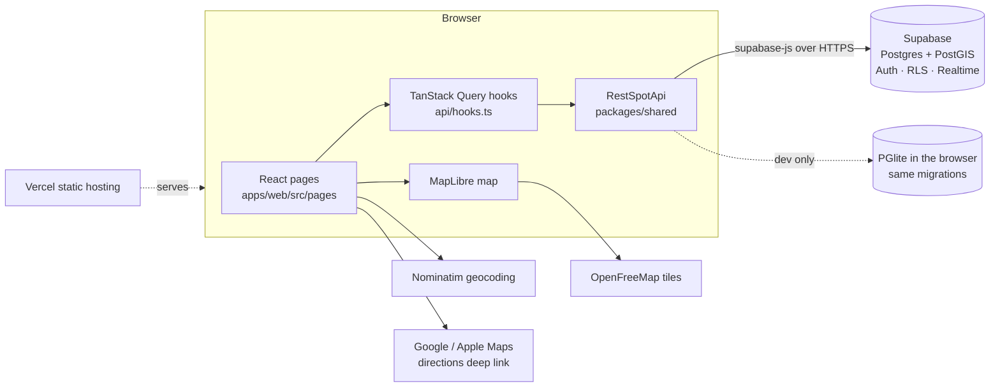
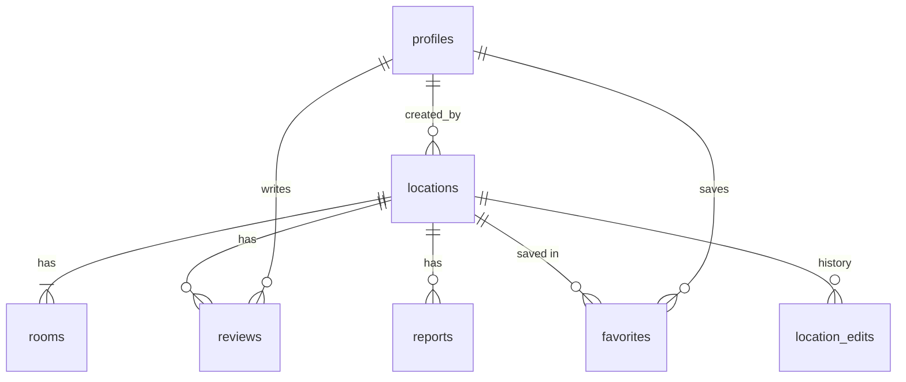

# Architecture

How RestSpot fits together. For _why_ each choice was made, see [DECISIONS.md](DECISIONS.md).

## The big picture



- The **website** is a static single-page app on Vercel. There is no custom server.
- **Supabase** is the whole backend: database, auth, and realtime. All rules live in the database.
- The **map** uses free OpenFreeMap tiles; **address search** uses free Nominatim; **directions**
  open the phone's maps app.

## One API, two backends

The UI never talks to Supabase directly. Everything goes through the `RestSpotApi` interface in
[`packages/shared/src/api.ts`](../packages/shared/src/api.ts):

```
RestSpotApi (api.ts)
  └─ createRestSpotApi (client.ts)         one implementation of every method
       ├─ Transport                        rpc / insert / update / delete / selectOne / subscribe
       │    ├─ Supabase (supabase.ts)      production
       │    └─ PGlite (apps/web/src/dev)   local development and tests
       └─ AuthAdapter                      sign in/up/out, OAuth, password reset
```

Both backends run the **same SQL** from `supabase/migrations`, so local development and the
end-to-end tests exercise the real schema, security rules, and functions. The mobile app will reuse
`packages/shared` unchanged and only supply its own UI.

## Data model



| Table            | What it holds                                                                                                                  |
| ---------------- | ------------------------------------------------------------------------------------------------------------------------------ |
| `profiles`       | One per user (created automatically on sign-up): display name, role (`user`/`admin`), suspension                               |
| `locations`      | One per map pin: name, PostGIS point, time zone, access, fee, key required, weekly hours, notes, source, verified, soft-delete |
| `rooms`          | Rooms at a location: men's/women's/all-gender × single-user/multi-stall/family, with accessibility and changing table          |
| `reviews`        | One per user per location: overall + cleanliness (1–5), optional comment, anonymous flag, hidden-by-admin flag                 |
| `reports`        | Problem reports (closed, wrong info, duplicate, inappropriate) for the admin queue                                             |
| `favorites`      | Saved locations per user                                                                                                       |
| `location_edits` | Field-level history of every change, with a snapshot for rollback                                                              |

Amenities are **tri-state** (`yes` / `no` / `unknown`) because "nobody said" isn't "no". Hours are
seven entries (Sunday first), each `unknown`, `closed`, `all_day`, or `open` with `HH:MM` times;
a closing time before the opening time means past midnight. "Open now" is computed in the
**restroom's** time zone.

## Security model

Clients use Supabase's public **anon key**, so the database itself enforces every rule:

- **Row-level security** is on for every table. Clients get only the table privileges they need.
- **Reads:** anyone can read active listings and rooms. Reviews are read through
  `get_location_reviews()`, which hides anonymous reviewers' names from everyone except admins.
- **Writes to listings** go only through `SECURITY DEFINER` functions (`save_location`,
  `confirm_location`, …) that check the caller is signed in and not suspended, validate input,
  rate-limit, and record edit history in the same transaction.
- **Admin functions** (`admin_*`) check the caller's role inside the database.
- Suspended users can browse but not contribute.

## Server functions (RPCs)

| Function                                                                                                                                                                                              | Who       | Purpose                                                                  |
| ----------------------------------------------------------------------------------------------------------------------------------------------------------------------------------------------------- | --------- | ------------------------------------------------------------------------ |
| `search_restrooms`                                                                                                                                                                                    | anyone    | Radius search (0.1–25 mi) with filters, sorted by distance, ≤500 results |
| `get_location`, `get_location_reviews`, `get_location_history`                                                                                                                                        | anyone    | Listing details, reviews, and edit history                               |
| `find_possible_duplicates`                                                                                                                                                                            | anyone    | Similar names (trigram) within 50 m                                      |
| `get_favorites`, `get_my_contributions`                                                                                                                                                               | signed in | Dashboard data                                                           |
| `save_location`, `confirm_location`, `save_my_review`, `delete_my_review`, `delete_my_account`                                                                                                        | signed in | Contributing                                                             |
| `admin_list_reports`, `admin_resolve_report`, `admin_set_location_deleted`, `admin_merge_locations`, `admin_rollback_location`, `admin_set_review_hidden`, `admin_list_users`, `admin_set_suspension` | admins    | Moderation                                                               |

Reports and favorites are written directly to their tables (row-level security checks them).

## The web app

```
main.tsx           Providers: React Query → ApiProvider → AuthProvider → SearchProvider → router
App.tsx            Routes
layout/AppShell    Header, nav, skip link, focus management on navigation
layout/MapLayout   Side panel + persistent map; pages drive the map through useMapControls()
pages/             Search, restroom detail, add/edit form, sign in/up/reset, dashboard (+ admin tabs)
api/hooks.ts       React Query hooks; refetches when the backend reports listing changes
search/            Search origin + filters (kept in sessionStorage)
map/               MapLibre setup and the map component (pins, radius, picker)
dev/               Local PGlite backend and sample data (dev builds only)
```

The map stays mounted while you move between pages. Pages tell it what to show (pins, the selected
pin, a draggable picker for add/edit) through `useMapControls()`.

## Seed data

`tools/osm-import` queries OpenStreetMap's Overpass API and writes a single SQL statement that
upserts listings by `source_ref` (e.g. `osm:node/123`). Mapped restrooms are `source = 'osm'`;
places that very likely have restrooms (rest areas, libraries, gas stations, major chains) are
`source = 'poi_inferred'`. Both start unverified, and re-running an import never overwrites
listings users have verified or edited. See [supabase/seed/README.md](../supabase/seed/README.md).

## Performance

- Search uses a PostGIS GiST index; 10,000 restrooms search in under 35 ms in tests (target: 500 ms).
- Results are cached by React Query and refreshed on realtime changes.
- The map library is the largest part of the bundle (~1.6 MB minified total); lazy-loading it is on
  the [to-do list](STATUS.md#next-steps).
